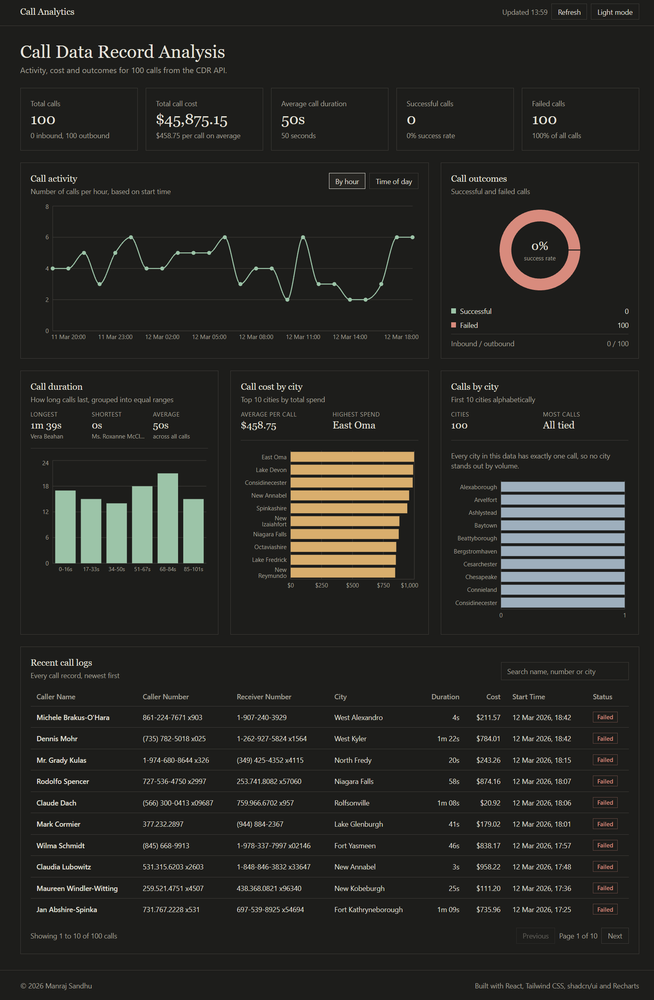

# Call Analytics Dashboard

Week 2 internship assignment: an analytics dashboard for Call Data Records (CDR). It fetches call records from a mock CDR API and turns them into summary metrics, charts and a searchable call log.

**Live dashboard:** vercel

## Features

- **KPI cards:** total calls, total call cost, average call duration, successful calls and failed calls
- **Call activity:** calls per day (or per month for longer date ranges), with a switch to view calls by hour of the day
- **Call outcomes:** donut chart of successful vs failed calls, plus inbound and outbound counts
- **Call duration:** longest, shortest and average call, with a histogram of duration ranges
- **Call cost:** average cost per call and total cost for the top 10 cities
- **Calls by city:** the 10 cities with the most calls
- **Recent call logs:** a shadcn/ui table of every call, newest first, with search and pagination
- Light and dark mode (remembers your choice), loading and error states, and a refresh button

## Tech stack

- [React](https://react.dev/) with [Vite](https://vite.dev/)
- [Tailwind CSS](https://tailwindcss.com/)
- [shadcn/ui](https://ui.shadcn.com/) components (Card, Table, Button, Badge, Input)
- [Recharts](https://recharts.org/) for the charts

## Data source

`https://69b30b45e224ec066bdb55a0.mockapi.io/api/v1/cdr`

The raw records are normalised in `src/lib/api.js` (for example `callCost` arrives as a string), and all metrics are calculated in `src/lib/analytics.js`.

## Running locally

Requires Node.js 18 or newer.

```bash
npm install
npm run dev
```

Then open the address Vite prints (usually http://localhost:5173).

To create a production build:

```bash
npm run build
npm run preview
```

## Project structure

```
src/
  App.jsx                  page layout
  components/
    ui/                    shadcn/ui components
    dashboard/             KPI cards, charts and the call log table
  hooks/                   data fetching and theme hooks
  lib/
    api.js                 fetches and cleans the CDR data
    analytics.js           turns calls into chart data
    format.js              currency, duration and date formatting
```

## Screenshots



## Deployment

Deployed on [Vercel](https://vercel.com/) from the GitHub repository. Vercel detects Vite automatically: build command `npm run build`, output directory `dist`.
